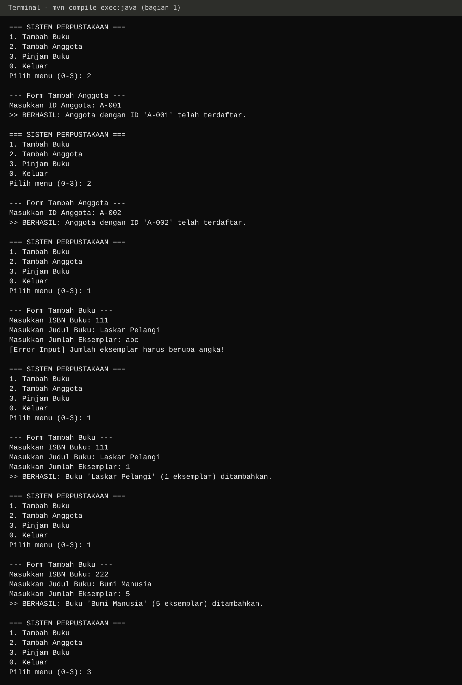
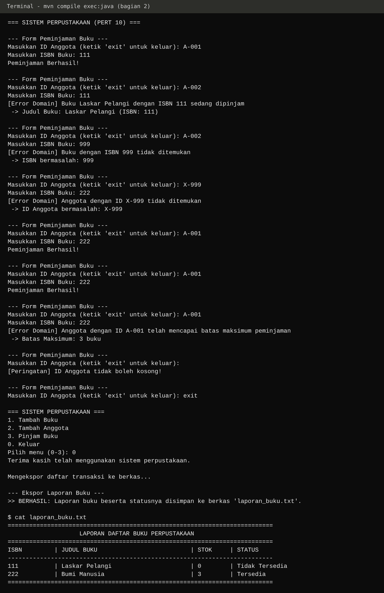
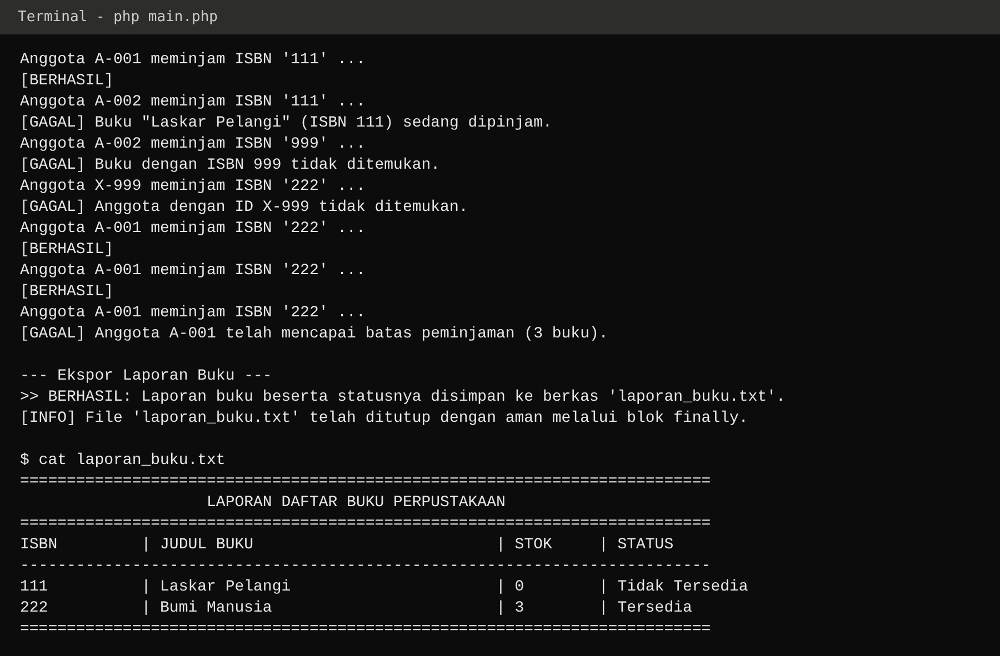

# LAPORAN PRAKTIKUM PEMROGRAMAN BERBASIS OBJEK

| Informasi Praktikan | Keterangan |

|---|---|

| **Nama** | Ayu Arimbi |

| **NPM** | 4525210140 |

| **Kelas** | A |

| **Mata Kuliah** | Pemrograman Berbasis Objek (PBO) |

| **Pertemuan** | [10] - [Exception Handling] |

| **Tanggal** | [06-11-2026] |

## 1. Implementasi Java

### 1.1 File LibraryServiceKotor.java dan LibraryService.java (refactoring)

### Sebelum

**Bagian yang harus dikerjakan:**

- **TODO 1 (Langkah 2)**: refaktor `pinjam()` supaya tidak bersarang empat tingkat. Gunakan *guard clause*: tiap syarat diperiksa di awal, lalu langsung gagal.

- **TODO 2**: ganti `return false` dengan exception yang menjelaskan **alasan** kegagalan, sehingga pemanggil tahu kenapa peminjaman gagal.

- **Pemeriksaan dilakukan secara berurutan:** data anggota, keberadaan buku, ketersediaan stok, kemudian batas peminjaman.

- **Aturan:** `LibraryServiceKotor` **tidak boleh dihapus**, karena dipakai sebagai pembanding saat demo.

**Keadaan sebelum diperbaiki:**

- `pinjam()` bersarang **empat tingkat** `if` dan mengembalikan `boolean`.

- Setiap cabang gagal hanya `return false;`, jadi pemanggil tidak bisa tahu penyebabnya (anggota salah, ISBN salah, stok habis, atau batas tercapai).

- Jika ada ketentuan tambahan, struktur percabangan akan semakin dalam dan sulit dibaca.

### Setelah

**Uraian kode:**

1. **Guard clause (TODO 1).** Empat `if` berurutan di awal `pinjam()`. Kalau satu syarat gagal, method langsung berhenti dengan `throw`.

2. **Logika utama tanpa nesting.** `stok.merge(isbn, -1, ...)` dan `pinjaman.merge(idAnggota, 1, ...)` ada di tingkat paling kiri, dijalankan hanya kalau semua guard lolos.

3. **Exception menjelaskan alasan (TODO 2).** Setiap jenis kesalahan ditangani dengan exception tersendiri, yaitu: `AnggotaTidakDitemukanException`, `BukuTidakDitemukanException`, `BukuSedangDipinjamException`, dan `BatasPinjamTerlampauiException`.

4. **Dokumentasi `@throws`** di atas `pinjam()` menyebut keempat exception beserta kondisinya.

5. **Konstanta `BATAS_PINJAM = 3`** digunakan pada pemeriksaan maupun exception agar nilai batas peminjaman cukup ditentukan pada satu bagian kode.

6. **`getSemuaJudul()`** ditambahkan untuk kebutuhan ekspor laporan di `Main`.

### 1.2 Hierarki exception (package exception)

### Sebelum

Belum ada. Pada kode awal kegagalan hanya ditandai `return false`, tidak ada kelas exception sama sekali.

**Bagian yang harus dikerjakan:**

- **TODO 1**: buat induk bersama `PerpustakaanException` supaya seluruh kegagalan domain bisa ditangkap dengan satu `catch`.

- **TODO 2**: buat empat class exception turunan yang **menyimpan informasi penyebab kesalahan**, bukan hanya menampilkan pesan.

- **Keputusan desain:** apakah menggunakan jenis *checked* atau *unchecked*? Sertakan alasan pemilihannya.

### Setelah

**`PerpustakaanException` (induk)**

**`BukuTidakDitemukanException`**

**`AnggotaTidakDitemukanException`**

**`BukuSedangDipinjamException`**

**`BatasPinjamTerlampauiException`**

**Uraian kode:**

1. **Induk (TODO 1).** `PerpustakaanException` bertipe `abstract` dan `extends RuntimeException`, dengan dua constructor (pesan, serta pesan + penyebab).

2. **Unchecked, bukan checked.** Kesalahan seperti ID anggota tidak valid, ISBN tidak ditemukan, stok kosong, dan batas pinjaman terlampaui muncul karena permintaan yang tidak sesuai aturan. Hal tersebut berbeda dari gangguan eksternal, misalnya file tidak tersedia atau koneksi jaringan terputus. Pemanggil tidak dipaksa menulis `try/catch` atau `throws` di setiap lapisan, tapi tetap bisa menangkap semuanya lewat satu `catch (PerpustakaanException e)`.

3. **Informasi yang disimpan oleh exception (TODO 2).**

   - `BukuTidakDitemukanException` membawa `isbn`.

   - `AnggotaTidakDitemukanException` membawa `idAnggota`.

   - `BukuSedangDipinjamException` membawa `isbn` dan `judul`.

   - `BatasPinjamTerlampauiException` membawa `idAnggota` dan `batas`.

4. **Kenapa membawa data.** Pemanggil bisa mengambil penyebabnya lewat getter (`getIsbn()`, `getBatas()`, dst.) tanpa harus mengurai kalimat pesan. Data ini juga yang nanti dipakai sebagai isi respons HTTP 404 pada sesi 13 dan 14.

### 1.3 File PerpustakaanService.java

### Sebelum

Belum ada penanganan exception di lapisan konsol. Karena `pinjam()` lama hanya mengembalikan `false`, antarmuka tidak bisa memberi pesan yang spesifik ke pengguna.

**Bagian yang harus dikerjakan:**

- **TODO 1**: tangkap `PerpustakaanException` dan tampilkan pesan beserta data penyebabnya.

- **TODO 2**: pisahkan kegagalan domain dari kesalahan tak terduga (bug) dengan dua blok `catch` yang berbeda.

- **TODO 3**: validasi input angka (`NumberFormatException`) supaya program tidak crash.

### Setelah

**Uraian kode:**

1. **`catch (PerpustakaanException e)` (TODO 1).** Menampilkan `[Error Domain]` plus pesannya. Lalu `instanceof` (pattern matching) dipakai untuk mengambil data khusus tiap jenis: ISBN, ID anggota, judul, atau batas maksimum.

2. **`catch (Exception e)` (TODO 2).** Dipisah dan diletakkan **setelah** catch domain. Ini untuk bug tak terduga, ditampilkan sebagai `[Error Sistem]` supaya tidak tercampur dengan kegagalan yang memang wajar.

3. **`NumberFormatException` (TODO 3).** Pada `tambahBuku()`, jumlah eksemplar `abc` menghasilkan `[Error Input]` dan program kembali ke menu, tidak crash. Angka `<= 0` juga ditolak.

4. **Validasi input kosong.** Jika kolom ID Anggota atau ISBN tidak diisi, program memberikan peringatan dan meminta pengguna mengisi formulir kembali.

5. **`exit`** pada formulir peminjaman dapat digunakan untuk membatalkan proses dan kembali ke menu utama.

### 1.4 File Main.java

### Sebelum

**Bagian yang harus dikerjakan:**

- **TODO 1**: ekspor laporan buku ke berkas `laporan_buku.txt`.

- **TODO 2**: berkas **harus selalu tertutup**, termasuk saat terjadi exception di tengah penulisan. Gunakan *try-with-resources*.

- **TODO 3**: tangani `IOException` dengan pesan yang jelas.

**Keadaan sebelum diperbaiki:** belum ada ekspor laporan ke berkas. Penulisan file adalah sumber exception (`IOException`) yang harus ditangani.

### Setelah

**Uraian kode:**

1. **try-with-resources (TODO 2).** `try (PrintWriter writer = new PrintWriter(new FileWriter(namaFile)))` membuat writer ditutup otomatis walau terjadi exception, tanpa blok `finally` manual.

2. **Isi laporan (TODO 1).** Header, kolom `ISBN | JUDUL BUKU | STOK | STATUS`, lalu tiap buku dengan status `Tersedia` jika stok `> 0`, selain itu `Tidak Tersedia`.

3. **`catch (IOException e)` (TODO 3).** Menampilkan `[ERROR FILE]` beserta penyebabnya.

4. **Menu.** `switch` memanggil `PerpustakaanService` untuk menu 1 sampai 3, dan menu `0` mengakhiri perulangan lalu mengekspor laporan.

### Screenshoot Main java

Skenario uji dijalankan lewat menu (daftar anggota, tambah buku termasuk input `abc`, tujuh percobaan pinjam, ID kosong, lalu keluar dan ekspor laporan).

## 2. Implementasi PHP

### 2.1 File LibraryServiceKotor.php dan LibraryService.php (refactoring)

### Sebelum

**Bagian yang harus dikerjakan:**

- **TODO 1**: refaktor `pinjam()` dengan *guard clause* (sama seperti versi Java).

- **TODO 2**: ganti `return false` dengan exception, dan ubah tipe kembalian menjadi `void`.

- **TODO 3**: tulis `@throws` di PHPDoc untuk setiap exception.

**Keadaan sebelum diperbaiki:** `pinjam()` bersarang empat tingkat dan mengembalikan `bool`. Setiap kegagalan hanya `return false;` sehingga alasannya tidak diketahui.

### Setelah

**Uraian kode:**

1. **Guard clause (TODO 1).** Urutannya sama dengan Java: `array_key_exists` untuk anggota, lalu ISBN, lalu `stok <= 0`, lalu batas pinjam.

2. **Exception, bukan `false` (TODO 2).** `pinjam()` sekarang `void`. Berhasil berarti tidak ada exception.

3. **`@throws` di PHPDoc (TODO 3).** Di PHP tidak ada *checked exception*, jadi kompilator tidak membantu pembaca kode. `@throws` menjadi dokumentasi utama tentang apa saja yang bisa dilempar.

4. **`final class` dan `const int BATAS_PINJAM = 3`** yang merupakan fitur typed constant pada PHP 8.3.

5. **`$this->pinjaman[$idAnggota] ??= 0`** menginisialisasi jumlah pinjaman anggota jika belum tersedia, tanpa mengganti nilai yang sebelumnya sudah tersimpan.

### 2.2 Hierarki exception (src/Exception)

### Sebelum

Belum ada kelas exception. Kegagalan hanya ditandai `return false`.

**Bagian yang harus dikerjakan:**

- **TODO 1**: buat induk `PerpustakaanException`.

- **TODO 2**: buat empat exception turunan yang membawa data penyebab, dengan properti `readonly`.

### Setelah

**`PerpustakaanException` (induk)**

**`BukuTidakDitemukanException`**

**`AnggotaTidakDitemukanException`**

**`BukuSedangDipinjamException`**

**`BatasPinjamTerlampauiException`**

**Uraian kode:**

1. **Induk (TODO 1).** `abstract class PerpustakaanException extends RuntimeException`. Dengan mewarisi RuntimeException, exception tersebut memiliki sifat yang sepadan dengan *unchecked exception* pada Java.

2. **Turunan `final` dengan constructor promotion (TODO 2).** Data penyebab disimpan sebagai `private readonly` (`isbn`, `idAnggota`, `judul`, `batas`) dan dibaca lewat getter.

3. **Pesan dibangun di dalam exception.** Pemanggil cukup memanggil `$e->getMessage()`.

### 2.3 File main.php

### Sebelum

**Bagian yang harus dikerjakan:**

- **TODO 1**: jalankan tujuh skenario peminjaman, tangkap kegagalan domain dengan satu `catch (PerpustakaanException $e)`.

- **TODO 2**: ekspor laporan ke `laporan_buku.txt`, dan pastikan file **selalu ditutup** walau ada exception (`try/catch/finally`).

**Keadaan sebelum diperbaiki:** belum ada demo skenario maupun ekspor laporan di `main.php`.

### Setelah

**Uraian kode:**

1. **Daftar skenario (TODO 1).** Array `$percobaan` berisi pasangan `[idAnggota, isbn]`, dijalankan dengan `foreach`. Satu `catch (PerpustakaanException $e)` menangkap keempat jenis kegagalan dan mencetak `[GAGAL]` beserta pesannya.

2. **`createReport()` (TODO 2).** Menulis laporan dengan `fopen`/`fwrite`. Blok `catch (\Exception $e)` menangani error tak terduga, dan blok **`finally`** menutup file dengan `fclose`, dijalankan baik sukses maupun gagal. PHP tidak punya try-with-resources seperti Java, jadi `finally` yang menjaminnya.

3. **`is_resource($fileHandle)`** dicek sebelum `fclose` agar tidak menutup handle yang tidak valid.

### Screenshoot Main php

## Skenario uji (sama untuk Java dan PHP)

| # | Anggota | ISBN | Hasil yang diharapkan | Hasil |

|---|---------|------|------------------------|-------|

| 1 | A-001 | 111 | Berhasil (stok 111: 1 menjadi 0) | Sesuai |

| 2 | A-002 | 111 | `BukuSedangDipinjamException` (judul + ISBN) | Sesuai |

| 3 | A-002 | 999 | `BukuTidakDitemukanException` (ISBN 999) | Sesuai |

| 4 | X-999 | 222 | `AnggotaTidakDitemukanException` (ID X-999) | Sesuai |

| 5 | A-001 | 222 | Berhasil (pinjaman A-001 = 2) | Sesuai |

| 6 | A-001 | 222 | Berhasil (pinjaman A-001 = 3) | Sesuai |

| 7 | A-001 | 222 | `BatasPinjamTerlampauiException` (batas 3) | Sesuai |

Skenario tambahan (Java, lewat menu): jumlah eksemplar `abc` menghasilkan `[Error Input]` tanpa crash, ID kosong di menu pinjam menghasilkan peringatan dan form diulang, dan menu `0` membuat `laporan_buku.txt` dengan writer tertutup otomatis.

## Penjelasan dan kesimpulan:

- **Sebelum vs sesudah:** `pinjam()` lama bersarang empat tingkat dan hanya mengembalikan `false`. Versi baru memakai empat guard clause dan empat exception, sehingga logika utama tidak bersarang dan setiap kegagalan punya alasan yang jelas.

- **Hierarki exception:** satu induk `PerpustakaanException` (unchecked) dengan empat turunan yang membawa data. Satu `catch` di induk menangkap semua kegagalan domain, sementara `catch (Exception)` terpisah untuk bug.

- **Pengelolaan resource:** Java memakai try-with-resources, PHP memakai `finally`. Keduanya menjamin berkas laporan tertutup walau terjadi error.

**Kesimpulan:**

1. **Exception lebih baik daripada `return false`**, karena pemanggil tahu **kenapa** operasi gagal dan bisa mengambil data penyebabnya.

2. **Guard clause** membuat kode rata, mudah dibaca, dan mudah ditambah aturan baru (cukup satu `if ... throw` lagi) tanpa menambah nesting.

3. **Exception yang menyimpan informasi tambahan** seperti ISBN, ID anggota, judul buku, dan batas pinjaman memberikan informasi yang lebih lengkap daripada pesan biasa. Data tersebut juga dapat digunakan kembali pada bagian program lain, misalnya untuk respons HTTP.

4. **Induk exception bersama** memungkinkan penanganan menyeluruh lewat satu `catch`, sambil tetap memisahkan kegagalan domain dari kesalahan pemrograman.

5. **Unchecked untuk kegagalan permintaan tidak sah.** Di Java dipilih `RuntimeException`, sedangkan di PHP semua exception memang setara unchecked, sehingga `@throws` di PHPDoc menjadi dokumentasinya.

6. **Menutup resource dengan benar** (try-with-resources / `finally`) mencegah kebocoran file saat terjadi error.